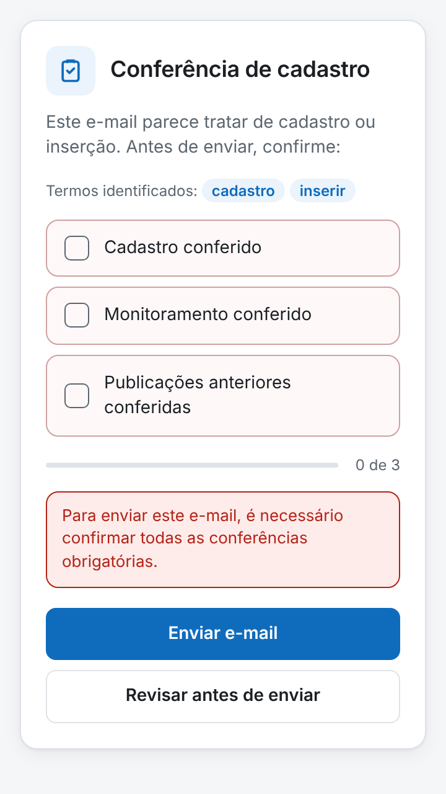
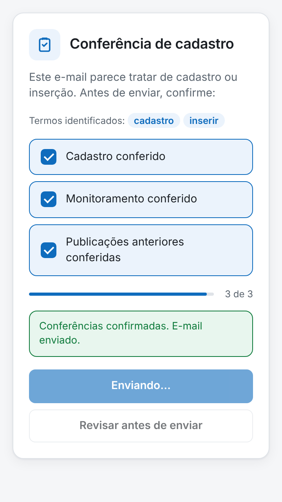

# Conferência de cadastro — suplemento do Outlook

Suplemento do Outlook (Web, novo Outlook e clássico no Windows) que usa **Smart Alerts / `OnMessageSend`**.
Quando o assunto ou o corpo do e-mail contém **cadastro, cadastrar, cadastramento, inserção ou inserir**
(sem diferenciar maiúsculas nem acentos, plurais incluídos), o envio é bloqueado até que as três conferências
obrigatórias sejam marcadas. Sem essas palavras, o e-mail é enviado normalmente, sem nenhum alerta.

## Como funciona

1. O usuário clica em **Enviar**. O `onMessageSendHandler` (`src/commands/commands.js`) lê assunto e corpo.
2. Sem palavra-chave → `allowEvent: true` (envio normal).
3. Com palavra-chave e sem confirmação → envio bloqueado. O alerta do Outlook mostra o botão
   **Conferência de cadastro**, que abre o painel (`commandId` do Smart Alerts, Mailbox 1.14+).
4. No painel (`src/taskpane/`):
   - **Enviar e-mail** com alguma caixa desmarcada → mostra *"Para enviar este e-mail, é necessário confirmar
     todas as conferências obrigatórias."* e não envia.
   - **Enviar e-mail** com as 3 marcadas → grava a confirmação em `sessionData` e chama `item.sendAsync()`.
     O `OnMessageSend` encontra a confirmação, libera o envio e a consome (vale para um envio só).
     Se o Outlook não tiver `sendAsync`, o painel pede para clicar em **Enviar** de novo.
   - **Revisar antes de enviar** → descarta a confirmação e fecha o painel.

| Bloqueado | Confirmado |
|---|---|
|  |  |

## Estrutura

```
manifest.xml                  Manifesto (LaunchEvent OnMessageSend + botão do painel)
src/commands/commands.html    Runtime do evento (Outlook na Web / novo Outlook)
src/commands/commands.js      Detecção das palavras-chave e lógica do OnMessageSend
src/taskpane/taskpane.html    Painel "Conferência de cadastro"
src/taskpane/taskpane.css     Visual (claro/escuro automático)
src/taskpane/taskpane.js      Regras dos checkboxes e dos botões
assets/                       Ícones 16/32/64/80/128
tests/keywords.test.js        Testes da detecção (node --test)
```

## Rodar localmente

Requer Node.js 18+.

```bash
npm run certs
```

```bash
npm start
```

(No macOS/Linux use `npm run start:unix`.) Os arquivos ficam em `https://localhost:3000`.

### Instalar no Outlook na Web (sideload)

1. Abra <https://aka.ms/olksideload> (ou Outlook na Web → **Aplicativos** → **Adicionar aplicativos** → **Meus suplementos**).
2. Em **Suplementos personalizados**, escolha **Adicionar de um arquivo** e selecione `manifest.xml`.
3. Escreva um e-mail com "cadastro" no assunto e clique em **Enviar**.

### Publicar para a organização

1. Hospede a pasta em um servidor HTTPS (Azure Static Web Apps, IIS, SharePoint etc.).
2. No `manifest.xml`, troque todas as ocorrências de `https://localhost:3000` pela URL final e gere um novo GUID em `<Id>`.
3. Implante pelo **Centro de administração do Microsoft 365 → Configurações → Aplicativos integrados**.
   Suplementos com `OnMessageSend` só podem ir para a loja do AppSource se usarem `SoftBlock`; pela implantação
   centralizada, `Block` é permitido.

## Ajustes comuns

- **Palavras-chave:** edite `CONFERENCIA.KEYWORDS` em `src/commands/commands.js` (escreva sem acento) e rode `npm test`.
- **Rigor do bloqueio:** `SendMode="Block"` no manifesto impede o envio inclusive se o suplemento estiver indisponível.
  Use `SoftBlock` se preferir liberar o envio nesse caso.
- **Falha ao ler o e-mail:** o handler libera o envio (para não travar todos os e-mails do usuário) e registra o erro no console.

## Requisitos de plataforma

| Recurso | Conjunto de requisitos |
|---|---|
| `OnMessageSend` / Smart Alerts | Mailbox 1.12 |
| `sessionData` | Mailbox 1.11 |
| Botão do alerta abrindo o painel (`commandId`, `cancelLabel`) | Mailbox 1.14 |
| Envio direto pelo painel (`item.sendAsync`) | Mailbox 1.15 (com fallback) |

Outlook na Web e o novo Outlook para Windows atendem a todos. Em versões mais antigas o fluxo continua funcionando:
o alerta orienta a abrir o painel pela faixa de opções, e após confirmar o usuário clica em **Enviar** novamente.
